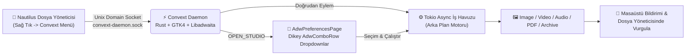

<div align="center">

# ⚡ Convext

### **GNOME / Linux için %100 Çevrimdışı (Offline), Bağlam Duyarlı Sağ Tık Dosya Dönüştürücü, Medya İşleyici ve Libadwaita Araç Stüdyosu**

[](https://www.rust-lang.org/)
[](https://www.gtk.org/)
[](https://gnome.pages.gitlab.gnome.org/libadwaita/)
[](https://tokio.rs/)
[](#)
[](#)

<p align="center">
  <b>Dosya yöneticisinde sağ tıklayın $\rightarrow$ Dosya türünüze özel dikey açılır menülerden (Dropdown) formatınızı veya aracınızı seçin $\rightarrow$ Arka planda sessizce tamamlansın!</b>
</p>

---

[🚀 Tek Komutla Kurulum](#-tek-komutla-hızlı-kurulum-one-line-install) •
[✨ Özellikler ve Desteklenen Formatlar](#-desteklenen-kategoriler-dönüştürücüler-ve-araçlar) •
[🎨 GNOME Libadwaita Arayüzü](#-gnome-gtk4--libadwaita-arayüz-mimarisi) •
[🏗️ Sistem Mimarisi](#️-sistem-mimarisi-ve-iş-akışı) •
[💻 CLI Kullanımı](#-komut-satırı-cli-ve-soket-kullanımı)

</div>

---

## 🌟 Neden Convext?

> [!IMPORTANT]
> **Sıfır Bulut Yüklemesi, Sıfır Bekleme:** Görsellerinizi, videolarınızı, ses kayıtlarınızı, PDF belgelerinizi veya arşivlerinizi dönüştürmek için internete dosya yüklemenize veya karmaşık terminal komutları yazmanıza gerek yok. **Convext**, doğrudan GNOME Dosyalar (**Nautilus**) sağ tık menüsüne ve yerel **GTK4 + Libadwaita** arayüzüne entegre olur.

* **🎯 Akıllı Bağlam Algılama (Context-Aware):** Bir `.png` görseline sağ tıkladığınızda yalnızca görsel dönüştürme/sıkıştırma/sansürleme araçları; bir `.mp4` videosuna sağ tıkladığınızda yalnızca video kırpma/birleştirme/ses ayıklama araçları; bir `.zip` arşivine sağ tıkladığınızda ise arşiv çıkarma ve dönüştürme araçları açılır.
* **📑 Dikey Açılır Menüler (Vertical Dropdowns):**
  * **Nautilus Sağ Tık Menüsünde:** Üst düzey tek kademeli kategori menüleri sayesinde alt menüler aynı popover içinde kaybolmadan doğrudan dikey liste olarak açılır.
  * **Convext Libadwaita Stüdyosunda (`AdwComboRow`):** Her kategori (**Format Dönüştürücü**, **Medya & Belge Araçları**, **Arşiv Araçları**, **Dosya İşlemleri**) kendi dikey açılır (dropdown) seçim kutusuna ve tek tıkla çalıştırma butonuna sahiptir.
* **🔇 Sessiz Arka Plan Motoru (Silent Background Worker):** Tüm ağır FFmpeg, QPDF, Pandoc, LibreOffice ve görüntü işleme görevleri `tokio` çoklu iş parçacığı havuzunda (multi-threaded runtime) sessizce yürütülür; işlem bittiğinde masaüstü bildirimi gönderilir ve üretilen dosya otomatik olarak dosya yöneticisinde vurgulanır.

---

## 🚀 Tek Komutla Hızlı Kurulum (One-Line Install)

Sistem bağımlılıklarını (`Fedora`, `Ubuntu/Debian`, `Arch Linux`, `openSUSE`), Rust derleyicisini, `convext` arka plan motorunu, `systemd` kullanıcı servisini ve Nautilus sağ tık eklentisini **tek komutla** indirip kurmak için terminalinize yapıştırın:

```bash
curl -fsSL https://raw.githubusercontent.com/mustazafi/convext/main/install.sh | bash
```

### Alternatif: Git ile Klonlayarak Kurulum

```bash
git clone https://github.com/mustazafi/convext.git
cd convext
chmod +x install.sh
./install.sh
```

> [!TIP]
> Kendi fork/depo adresinizden kurulum yapmak isterseniz `CONVEXT_REPO_URL` ortam değişkenini kullanabilirsiniz:
> ```bash
> CONVEXT_REPO_URL="https://github.com/<KULLANICI_ADINIZ>/convext.git" ./install.sh
> ```

---

## 🎨 GNOME GTK4 & Libadwaita Arayüz Mimarisi

**Convext**, GNOME İnsan Arayüzü Yönergelerine (**GNOME HIG**) tam uyumlu olarak yerel **GTK4 (`v4.12+`)** ve **Libadwaita (`v1.4+`)** bileşenleriyle inşa edilmiştir:

1. **`ConvextStudioWindow` (`adw::Window` + `adw::PreferencesPage`):**
   * Sağ tık menüsünden **`Convext Menü (Adwaita Açılır Panel)...`** seçildiğinde açılır.
   * İçerisinde alt alta dizilmiş **4 adet `adw::PreferencesGroup`** ve her grupta dikey açılır **`adw::ComboRow` (Dropdown)** yer alır:
     * **Format Dönüştürücü (`Convert Format`):** Dosya türüne göre hedef formatı açılır listeden seçip **Dönüştür** butonuyla başlatma.
     * **Medya & Belge Araçları (`Specialized Tools`):** Sıkıştırma, kırpma, hız değiştirme, birleştirme, QR okuma ve metadata temizleme araçlarını açılır listeden seçip **Çalıştır** butonuyla başlatma.
     * **Arşiv Araçları (`Archive Tools`):** Seçili dosyalardan `.zip`, `.tar`, `.tar.gz` oluşturma veya mevcut arşivi klasöre çıkarma.
     * **Dosya İşlemleri (`File Actions`):** Toplu yeniden adlandırma, Float rafına sabitleme, LocalSend/AirDrop, dosya yolu kopyalama ve terminal açma.
2. **Yerel Libadwaita Yardımcı Modalları:**
   * **Hedef Boyut Sıkıştırıcı (`TargetSizeModal`):** `adw::EntryRow` ve `adw::ComboRow` (`KB` / `MB`) ile görsel (Binary Search) ve videoları (Bitrate Solver) tam istediğiniz dosya boyutuna indirger.
   * **Medya Kırpıcı & Tempo (`MediaTrimmerModal`):** `adw::ActionRow` + `gtk4::Scale` ile başlangıç/bitiş saniyesini ve `0.5x – 2.0x` oynatma hızını ayarlar.
   * **Görsel Sansürleme & Kırpma (`ImageEditorModal`):** `adw::ToolbarView` + `adw::HeaderBar` üzerinde geri döndürülemez **Mozaik (`Pixelate`)**, **Karartma (`Blackout`)** ve **Kırpma (`Crop`)** uygular.
   * **Toplu Yeniden Adlandırıcı (`BatchRenameModal`):** `{name}_{index}_{date}` şablonlarıyla canlı önizlemeli (`adw::ActionRow`) çoklu dosya adlandırma.
   * **Yüzen Dosya Rafı (`FloatShelfWindow`):** `boxed-list` stilinde `adw::ActionRow` satırlarıyla dosyaları geçici olarak toplayıp tek seferde sürükleme veya işleme.

---

## ✨ Desteklenen Kategoriler, Dönüştürücüler ve Araçlar

| Kategori | Algılanan Uzantılar | Hedef Dönüştürme Formatları (`Convert`) | Özel Araçlar (`Specialized Tools`) |
| :--- | :--- | :--- | :--- |
| **🖼️ Görsel** | `png`, `jpg`, `jpeg`, `webp`, `avif`, `heic`, `heif`, `gif`, `bmp`, `tiff`, `svg`, `ico` | `PNG`, `JPG`, `WEBP`, `AVIF`, `HEIC`, `GIF`, `BMP`, `TIFF`, `ICO`, `PDF` | • Kaliteye Göre Sıkıştır (`%85`, `%65`, `%40`)<br>• Hedef Boyuta Sıkıştır (`MB / KB` Binary Search)<br>• Görsel Kırp & Sansürle (`Pixelate / Blackout / Crop`)<br>• Koyu Arka Plan Çerçevesi Ekle<br>• Çoklu Görseli Tek PDF Yap (`PDF Collage`)<br>• QR Kodu Oku ve Panoya Kopyala<br>• EXIF / Metadata Temizle |
| **🎬 Video** | `mp4`, `mov`, `mkv`, `webm`, `avi`, `wmv`, `flv`, `m4v` | `MP4`, `MOV`, `MKV`, `WEBM`, `AVI`, `GIF`, `MP3 (Sesi Ayıkla)` | • Videoyu Hızlı Sıkıştır (`H.264 CRF 28`)<br>• Hedef Boyuta Sıkıştır (`MB / KB` Bitrate Solver)<br>• Videoları Birleştir (`Join Videos`)<br>• Videoyu Kırp / Kes (`Trim Video`)<br>• Videoyu İkiye Böl (`Split Video`)<br>• Videoyu Kadrajla (`Crop Video`)<br>• Oynatma Hızını Değiştir (`0.5x – 2.0x`)<br>• Sesi Kaldır (`Remove Audio / Mute`)<br>• Videodan Kare Yakala (`Save Frame PNG`)<br>• Videoyu Sansürle (`Redact Video`)<br>• Metadata Temizle |
| **🎵 Ses** | `mp3`, `wav`, `flac`, `m4a`, `aac`, `ogg`, `opus`, `aiff`, `wma` | `MP3`, `WAV`, `FLAC`, `M4A`, `AAC`, `OGG`, `OPUS`, `AIFF` | • Sesi Sıkıştır (`Compress Audio`)<br>• Sesi Kırp & Hız Değiştir (`Trim & Speed`)<br>• Ses Seviyesini Dengele (`EBU R128 Normalize`)<br>• Ses Dalga Videosu Oluştur (`Waveform MP4`)<br>• Mono / Stereo Kanal Değiştir<br>• Orta Bölümü Sansürle (`1000Hz Sine Bleep`)<br>• Metadata Temizle |
| **📄 PDF** | `pdf` | `DOCX`, `PAGES`, `TXT`, `MD`, `HTML`, `EPUB`, `PNG (300 DPI)`, `JPG (300 DPI)` | • PDF Boyutunu Sıkıştır (`Compress PDF`)<br>• PDF Sayfalarını Tek Tek Ayır (`Split PDF`)<br>• Seçili PDF'leri Birleştir (`Merge PDFs`)<br>• PDF Yapısını Optimize Et (`Linearize`)<br>• PDF Metadata Temizle |
| **📝 Belge & Kitap** | `docx`, `doc`, `odt`, `pages`, `md`, `txt`, `rtf`, `html`, `epub` | `PDF`, `DOCX`, `ODT`, `PAGES`, `EPUB`, `MD`, `TXT`, `HTML`, `PNG`, `JPG` | • Seçili Belgelerden `ZIP` / `TAR` / `GZIP` Oluştur<br>• Metadata Temizle |
| **📊 Tablo** | `csv`, `xlsx`, `xls`, `ods`, `numbers`, `tsv` | `XLSX`, `CSV`, `NUMBERS`, `PDF`, `HTML`, `MD` | • Delimiter Dönüşümü ve Arşivleme |
| **📽️ Sunum** | `pptx`, `ppt`, `odp`, `key` | `PDF`, `PPTX`, `KEY`, `PNG (Slaytlar)`, `JPG (Slaytlar)` | • Slayt Dışa Aktarma ve Arşivleme |
| **💬 Altyazı** | `srt`, `vtt`, `ass`, `sub` | `VTT`, `SRT`, `TXT (Zaman Damgasız Metin)` | • Otomatik Zaman Damgası Temizleme |
| **📦 Arşiv** | `zip`, `tar`, `tar.gz`, `tgz`, `7z`, `rar`, `bz2`, `xz` | `ZIP`, `TAR`, `GZIP (.tar.gz)` | • Klasöre Çıkart (`Extract Here`)<br>• Arşiv Formatını Dönüştür |

---

## 🏗️ Sistem Mimarisi ve İş Akışı



### Proje Dizin Yapısı

```text
convext/
├── Cargo.toml                  # Rust paket yapılandırması (convext, gtk4, libadwaita, tokio, image, zip, tar)
├── install.sh                  # Tek komutla tüm bağımlılıkları, servisi ve eklentiyi kuran betik
├── uninstall.sh                # Sistemden tamamen kaldırma betiği
├── run_convext.sh              # Geliştirici derleme, örnek dosya üretme ve test betiği
├── assets/
│   ├── convext_menu.py         # Nautilus 4.0 / 4.1 sağ tık menü eklentisi
│   └── style.css               # GTK4 / Libadwaita tamamlayıcı stiller
└── src/
    ├── main.rs                 # Libadwaita başlatıcı, Unix soket & CLI (--convext) yönlendiricisi
    ├── config.rs               # ConvextConfig (~/.config/convext/config.toml) ve binary tespiti
    ├── error.rs                # ConvextError & ConvextResult hata yönetimi
    ├── daemon/
    │   ├── mod.rs              # DaemonEvent tanımları
    │   ├── tray.rs             # Unix soket sunucusu ($XDG_RUNTIME_DIR/convext-daemon.sock)
    │   ├── input_listener.rs   # Global kısayol dinleyicisi
    │   └── surface_bridge.rs   # Wayland / X11 pencere yardımcıları
    ├── desktop/
    │   ├── actions.rs          # Pano, terminal, LocalSend ve bildirim eylemleri
    │   └── file_manager.rs     # org.freedesktop.FileManager1.ShowItems köprüsü
    ├── engine/
    │   ├── mime_router.rs      # Magic-byte ve uzantı tabanlı dosya sınıflandırıcı
    │   ├── image_proc.rs       # Görsel dönüştürme, % sıkıştırma, Binary-Search hedef boyut, sansürleme
    │   ├── video_proc.rs       # FFmpeg video dönüştürme, Bitrate Solver, trim, split, join, crop, mute
    │   ├── audio_proc.rs       # FFmpeg ses dönüştürme, EBU R128 normalize, waveform MP4, bleep
    │   ├── pdf_proc.rs         # QPDF / Poppler PDF dönüştürme, birleştirme, ayırma, sıkıştırma
    │   ├── doc_proc.rs         # Pandoc / LibreOffice belge, tablo, sunum ve altyazı dönüştürücü
    │   ├── archive_proc.rs     # ZIP, TAR, GZIP oluşturma, çıkarma ve dönüştürme
    │   └── privacy_qr.rs       # ExifTool metadata temizleyici ve RQRR çevrimdışı QR okuyucu
    └── ui/
        ├── convext_studio.rs   # GNOME Libadwaita (AdwWindow + AdwComboRow dropdownlar) ana penceresi
        ├── float_shelf.rs      # Libadwaita yüzen dosya rafı (Floating Shelf)
        └── modals/
            ├── target_size.rs  # Libadwaita hedef dosya boyutu (KB/MB) penceresi
            ├── media_trimmer.rs# Libadwaita video/ses kırpma ve hız ayar penceresi
            ├── image_editor.rs # Libadwaita görsel sansürleme ve kırpma editörü
            └── batch_rename.rs # Libadwaita şablon tabanlı toplu yeniden adlandırıcı
```

---

## 💻 Komut Satırı (CLI) ve Soket Kullanımı

Sağ tık menüsüne ek olarak `convext` ikili dosyasını doğrudan terminalden veya kendi betiklerinizden çağırabilirsiniz:

```bash
# Seçili dosya(lar) için Libadwaita Dropdown Stüdyo penceresini aç
~/.local/bin/convext --convext OPEN_STUDIO /path/to/dosya.png

# Bir görseli arka planda sessizce WEBP formatına dönüştür
~/.local/bin/convext --convext IMG_CONVERT:webp /path/to/gorsel.png

# Bir videoyu arka planda hızlı sıkıştır
~/.local/bin/convext --convext VID_QUICK_COMPRESS /path/to/video.mp4

# Birden fazla videoyu tek MP4 dosyasında birleştir
~/.local/bin/convext --convext VID_JOIN klip1.mp4 klip2.mp4

# Bir arşivi bulunduğu klasöre çıkart
~/.local/bin/convext --convext ARC_EXTRACT /path/to/arsiv.zip
```

---

## 🔧 Servis Yönetimi ve Kaldırma

Arka plan servisinin durumunu kontrol etmek veya yeniden başlatmak için:

```bash
systemctl --user status convext.service
systemctl --user restart convext.service
```

Sistemden tamamen kaldırmak için:

```bash
chmod +x uninstall.sh
./uninstall.sh
```
