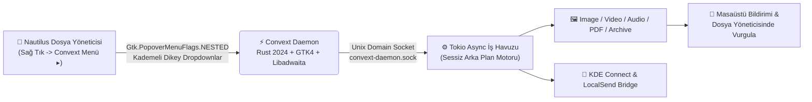

<div align="center">


# ⚡ Convext

### **GNOME / Linux için %100 Çevrimdışı (Offline), Bağlam Duyarlı Sağ Tık Dosya Dönüştürücü, Medya İşleyici ve Libadwaita Araç Stüdyosu**

[-F74C00?style=for-the-badge&logo=rust&logoColor=white)](https://www.rust-lang.org/)
[](https://www.gtk.org/)
[](https://gnome.pages.gitlab.gnome.org/libadwaita/)
[](https://tokio.rs/)
[](#)
[](#)

<p align="center">
  <b>Dosya yöneticisinde sağ tıklayın $\rightarrow$ Dosya türünüze özel kademeli açılır menülerden (Dropdown) formatınızı veya aracınızı seçin $\rightarrow$ Arka planda sessizce tamamlansın!</b>
</p>

---

[🚀 Tek Komutla Kurulum](#-tek-komutla-hızlı-kurulum-one-line-install) •
[✨ Dönüştürücü & Araç Matrisi](#-desteklenen-kategoriler-dönüştürücüler-ve-araçlar) •
[🎨 GNOME Libadwaita & Kademeli Menü](#-gnome-gtk4--libadwaita-arayüz-mimarisi) •
[📲 KDE Connect & LocalSend](#-kde-connect--localsend-ortak-paylaşım-köprüsü) •
[🏗️ Sistem Mimarisi](#️-sistem-mimarisi-ve-iş-akışı) •
[💻 CLI Kullanımı](#-komut-satırı-cli-ve-soket-kullanımı)

</div>

---

## 🌟 Neden Convext?

> [!IMPORTANT]
> **Sıfır Bulut Yüklemesi, Sıfır Bekleme:** Görsellerinizi, videolarınızı, ses kayıtlarınızı, PDF belgelerinizi veya arşivlerinizi dönüştürmek için internete dosya yüklemenize veya karmaşık terminal komutları yazmanıza gerek yok. **Convext**, doğrudan GNOME Dosyalar (**Nautilus**) sağ tık menüsüne ve yerel **GTK4 + Libadwaita** arayüzüne entegre olur.

* **🎯 Akıllı Bağlam Algılama (Context-Aware):** Bir `.png` görseline sağ tıkladığınızda yalnızca görsel dönüştürme/sıkıştırma/sansürleme araçları; bir `.mp4` videosuna sağ tıkladığınızda yalnızca video kırpma/birleştirme/ses ayıklama araçları; bir `.zip` arşivine sağ tıkladığınızda ise arşiv çıkarma ve dönüştürme araçları açılır.
* **📑 Kademeli Açılır Menüler (`Gtk.PopoverMenuFlags.NESTED`):**
  * Nautilus sağ tık menüsünde **`Convext Menü ▸`** üzerine geldiğinizde aynı menü sayfasının içinde kaybolmaz; her alt kategori (**Format Dönüştür ▸**, **Araçlar ▸**, **Arşiv Araçları ▸**, **Cihaza Gönder ▸**, **Dosya İşlemleri ▸**) **kendi ayrı dikey açılır penceresinde (cascading dropdown)** yan yana açılır.
* **🦀 Rust 2024 Edition + Tokio Çoklu İş Parçacığı Motoru:** Tüm ağır FFmpeg, QPDF, Pandoc, LibreOffice ve görüntü işleme görevleri `tokio` multi-threaded çalışma zamanında sessizce yürütülür; işlem bittiğinde masaüstü bildirimi gönderilir ve üretilen dosya otomatik olarak dosya yöneticisinde vurgulanır.

---

## 🚀 Tek Komutla Hızlı Kurulum (One-Line Install)

Sistem bağımlılıklarını (`Fedora`, `Ubuntu/Debian`, `Arch Linux`, `openSUSE`), Rust derleyicisini, `convext` arka plan motorunu, `systemd` kullanıcı servisini ve Nautilus sağ tık eklentisini **tek komutla** indirip kurmak için terminalinize yapıştırın:

```bash
curl -fsSL https://raw.githubusercontent.com/mustazafi/convext/main/install.sh | bash
```

### Alternatif: Git ile Klonlayarak Kurulum

```bash
git clone https://github.com/mustazafi/convext.git
cd convext
chmod +x install.sh
./install.sh
```

> [!TIP]
> Kendi fork/depo adresinizden kurulum yapmak isterseniz `CONVEXT_REPO_URL` ortam değişkenini kullanabilirsiniz:
> ```bash
> CONVEXT_REPO_URL="https://github.com/<KULLANICI_ADINIZ>/convext.git" ./install.sh
> ```

---

## ✨ Desteklenen Kategoriler, Dönüştürücüler ve Araçlar

<div align="center">

| Kategori & Modül | Algılanan Kaynak Uzantılar | 🔄 Hedef Dönüştürme Formatları (`Convert`) | 🛠️ Özel Medya & Belge Araçları (`Specialized Tools`) |
| :---: | :--- | :--- | :--- |
| <br/><sub><b>Image Engine</b></sub> | `png` `jpg` `jpeg`<br/>`webp` `avif` `heic`<br/>`heif` `gif` `bmp`<br/>`tiff` `svg` `ico` |     <br/>     | ⚡ **Hızlı Sıkıştırma:** `%85 (Yüksek)`, `%65 (Dengeli)`, `%40 (Maks)`<br/>🎯 **Hedef Boyut (`Binary Search`):** Tam `KB` / `MB` boyutuna indirgeme<br/>🕵️ **Kalıcı Sansürleme & Kırpma:** `Pixelate`, `Blackout`, `Crop`<br/>🖼️ **Stüdyo Çerçeve:** Koyu arka plan dolgusu ekleme<br/>📑 **Çoklu Görsel $\rightarrow$ PDF:** Seçili görselleri tek PDF'te birleştirme<br/>📱 **Çevrimdışı QR Okuyucu:** QR içeriğini çözüp panoya kopyalama<br/>🧹 **Gizlilik:** EXIF / GPS / Kamera üst verilerini sıfırlama |
| <br/><sub><b>Video Engine</b></sub> | `mp4` `mov` `mkv`<br/>`webm` `avi` `wmv`<br/>`flv` `m4v` |   <br/>  <br/> | ⚡ **Hızlı Sıkıştırma:** `H.264 CRF 28` tek tıkla küçültme<br/>🎯 **Hedef Boyut (`Bitrate Solver`):** Tam `MB` / `KB` hedef boyutu<br/>🔗 **Video Birleştirici (`Join`):** Çoklu klibi kayıpsız tek MP4 yapma<br/>✂️ **Kırp & Hız Değiştir (`Trim & Speed`):** Başlangıç/bitiş ve `0.5x–2.0x` hız<br/>➗ **İkiye Böl (`Split`):** Videoyu tam ortadan iki ayrı dosyaya bölme<br/>📐 **Kadrajla (`Crop`) & Sessize Al (`Mute`):** Ses kanalını kaldırma<br/>📸 **Kare Yakala (`Snapshot PNG`) & Sansürle (`Redact Video`)** |
| <br/><sub><b>Audio Engine</b></sub> | `mp3` `wav` `flac`<br/>`m4a` `aac` `ogg`<br/>`opus` `aiff` `wma` |   <br/>  <br/>  | 🎚️ **EBU R128 Ses Dengeleme:** Stüdyo standardı `-16 LUFS` normalize<br/>✂️ **Ses Kesici & Tempo:** Saniye bazlı kesme ve hızlandırma<br/>📊 **Ses Dalga Videosu (`Waveform MP4`):** Sesten `1280x720` görsel video<br/>🔊 **Kanal Dönüştürücü:** `Mono` $\leftrightarrow$ `Stereo` geçişi<br/>🔕 **Bleep Sansürleme:** Orta kesite `1000Hz` bip tonu uygulama<br/>🗜️ **Ses Sıkıştırma & ID3 Metadata Temizleme** |
| <br/><sub><b>PDF Engine</b></sub> | `pdf` |    <br/>    | 🗜️ **PDF Sıkıştırma:** Akış ve nesne sıkıştırma (`QPDF`)<br/>📑 **Sayfaları Ayır (`Split`):** Her sayfayı ayrı PDF dosyasına bölme<br/>🔗 **PDF Birleştir (`Merge`):** Çoklu PDF seçimini tek belgede birleştirme<br/>⚡ **Web Optimize (`Linearize`):** Hızlı görüntüleme için yeniden indeksleme<br/>🧹 **PDF Yazar / Üst Veri Temizleme** |
| <br/><sub><b>Doc & E-Book</b></sub> | `docx` `doc` `odt`<br/>`pages` `md` `txt`<br/>`rtf` `html` `epub` |    <br/>   <br/>  | 🔄 **Çift Motorlu Dönüşüm:** `Pandoc` + `LibreOffice Headless`<br/>📸 **Belgeden Görsele:** Belgeleri doğrudan yüksek çözünürlüklü `PNG`/`JPG` sayfalara çevirme<br/>📦 **Hızlı Paketleme:** Tek tıkla `ZIP`, `TAR` veya `GZIP` arşivleme |
| <br/><sub><b>Sheet & Slides</b></sub> | `csv` `xlsx` `ods`<br/>`numbers` `tsv`<br/>`pptx` `odp` `key` |   <br/>  <br/>  | 📊 **Akıllı Tablo Dönüşümü:** `CSV` $\leftrightarrow$ `XLSX` / `PDF` / `HTML` / `Markdown`<br/>📽️ **Slayt Dışa Aktarıcı:** Sunum slaytlarını tek tek `PNG` veya `JPG` görsellere dönüştürme |
| <br/><sub><b>Subtitles & Archive</b></sub> | `srt` `vtt` `ass` `sub`<br/>`zip` `tar` `tar.gz`<br/>`tgz` `7z` `rar` `xz` |   <br/>   | 💬 **Zaman Damgası Temizleyici:** `.srt` / `.vtt` dosyalarından zaman kodlarını söküp saf metin (`.txt`) çıkarma<br/>📂 **Klasöre Çıkart (`Extract Here`):** Arşivleri otomatik alt klasöre açma<br/>🔄 **Arşiv Format Dönüştürücü:** `7z`/`RAR`/`TAR` $\leftrightarrow$ `ZIP`/`TAR.GZ` |

</div>

---

## 📲 KDE Connect & LocalSend Ortak Paylaşım Köprüsü

**Convext**, yerel ağınızdaki telefon ve bilgisayarlara sıfır tıklamayla dosya göndermek için **KDE Connect** (`kdeconnect-cli` / `kdeconnect-handler`) ve **LocalSend** (Flatpak `org.localsend.localsend_app` + Native) ile entegre çalışır:

* **`Hızlı Gönder (KDE Connect / LocalSend Otomatik)`:** Eşleşmiş ve ulaşılabilir bir KDE Connect cihazınız (ör. *Galaxy S22*) varsa ek pencere açmadan dosyayı doğrudan telefonunuza gönderir; aktif KDE Connect cihazı yoksa otomatik olarak LocalSend'i başlatır.
* **Canlı Cihaz Listesi:** Sağ tık menüsü açıldığı anda ağdaki aktif KDE Connect cihazlarınız (`KDE Connect: <Cihaz Adı> Cihazına Gönder`) menüde otomatik listelenir.

---

## 🎨 GNOME GTK4 & Libadwaita Arayüz Mimarisi

**Convext**, GNOME İnsan Arayüzü Yönergelerine (**GNOME HIG**) tam uyumlu olarak yerel **GTK4 (`v4.12+`)** ve **Libadwaita (`v1.9`)** bileşenleriyle inşa edilmiştir:

1. **Kademeli Sağ Tık Menüsü (`Gtk.PopoverMenuFlags.NESTED`):**
   * Nautilus'un `Gtk.PopoverMenu` nesnelerine çalışma zamanında `NESTED` bayrağı uygulanır. Böylece **`Convext Menü ▸`** üzerine gelindiğinde menü aynı pencerede değişmez, her alt kategori kendi ayrı dikey açılır penceresinde (cascading dropdown) açılır.
2. **Yerel Libadwaita Yardımcı Modalları:**
   * **Hedef Boyut Sıkıştırıcı (`TargetSizeModal`):** `adw::EntryRow` ve `adw::ComboRow` (`KB` / `MB`) ile görsel (Binary Search) ve videoları (Bitrate Solver) tam istediğiniz dosya boyutuna indirger.
   * **Medya Kırpıcı & Tempo (`MediaTrimmerModal`):** `adw::ActionRow` + `gtk4::Scale` ile başlangıç/bitiş saniyesini ve `0.5x – 2.0x` oynatma hızını ayarlar.
   * **Görsel Sansürleme & Kırpma (`ImageEditorModal`):** `adw::ToolbarView` + `adw::HeaderBar` üzerinde geri döndürülemez **Mozaik (`Pixelate`)**, **Karartma (`Blackout`)** ve **Kırpma (`Crop`)** uygular.
   * **Toplu Yeniden Adlandırıcı (`BatchRenameModal`):** `{name}_{index}_{date}` şablonlarıyla canlı önizlemeli (`adw::ActionRow`) çoklu dosya adlandırma.
   * **Yüzen Dosya Rafı (`FloatShelfWindow`):** `boxed-list` stilinde `adw::ActionRow` satırlarıyla dosyaları geçici olarak toplayıp tek seferde sürükleme veya işleme.

---

## 🏗️ Sistem Mimarisi ve İş Akışı



### Proje Dizin Yapısı

```text
convext/
├── Cargo.toml                  # Rust 2024 Edition yapılandırması (convext, gtk4, libadwaita, tokio)
├── install.sh                  # Tek komutla tüm bağımlılıkları, servisi ve eklentiyi kuran betik
├── uninstall.sh                # Sistemden tamamen kaldırma betiği
├── run_convext.sh              # Geliştirici derleme, örnek dosya üretme ve test betiği
├── assets/
│   ├── logo.svg                # Convext vektörel GNOME squircle logosu
│   ├── convext_menu.py         # Nautilus 4.0 / 4.1 kademeli (NESTED) sağ tık menü eklentisi
│   └── style.css               # GTK4 / Libadwaita tamamlayıcı stiller
└── src/
    ├── main.rs                 # Libadwaita başlatıcı, Unix soket & CLI (--convext) yönlendiricisi
    ├── config.rs               # ConvextConfig (~/.config/convext/config.toml) ve binary tespiti
    ├── error.rs                # ConvextError & ConvextResult hata yönetimi
    ├── daemon/                 # Unix soket sunucusu ($XDG_RUNTIME_DIR/convext-daemon.sock)
    ├── desktop/                # KDE Connect, LocalSend, pano, terminal ve DBus ShowItems köprüsü
    ├── engine/                 # Görsel, Video, Ses, PDF, Belge, Arşiv ve QR/EXIF motorları
    └── ui/                     # Libadwaita pencereleri (Hedef Boyut, Kırpıcı, Sansürleyici, Float Rafı)
```

---

## 💻 Komut Satırı (CLI) ve Soket Kullanımı

Sağ tık menüsüne ek olarak `convext` ikili dosyasını doğrudan terminalden veya kendi betiklerinizden çağırabilirsiniz:

```bash
# Bir görseli arka planda sessizce WEBP formatına dönüştür
~/.local/bin/convext --convext IMG_CONVERT:webp /path/to/gorsel.png

# Bir videoyu arka planda hızlı sıkıştır
~/.local/bin/convext --convext VID_QUICK_COMPRESS /path/to/video.mp4

# Birden fazla videoyu tek MP4 dosyasında birleştir
~/.local/bin/convext --convext VID_JOIN klip1.mp4 klip2.mp4

# Dosyayı KDE Connect veya LocalSend üzerinden hızlı gönder
~/.local/bin/convext --convext ACT_AIRDROP /path/to/dosya.pdf

# Bir arşivi bulunduğu klasöre çıkart
~/.local/bin/convext --convext ARC_EXTRACT /path/to/arsiv.zip
```

---

## 🔧 Servis Yönetimi ve Kaldırma

Arka plan servisinin durumunu kontrol etmek veya yeniden başlatmak için:

```bash
systemctl --user status convext.service
systemctl --user restart convext.service
```

Sistemden tamamen kaldırmak için:

```bash
chmod +x uninstall.sh
./uninstall.sh
```
